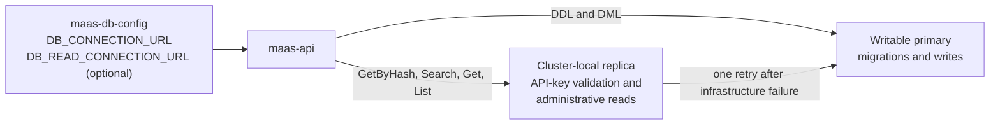
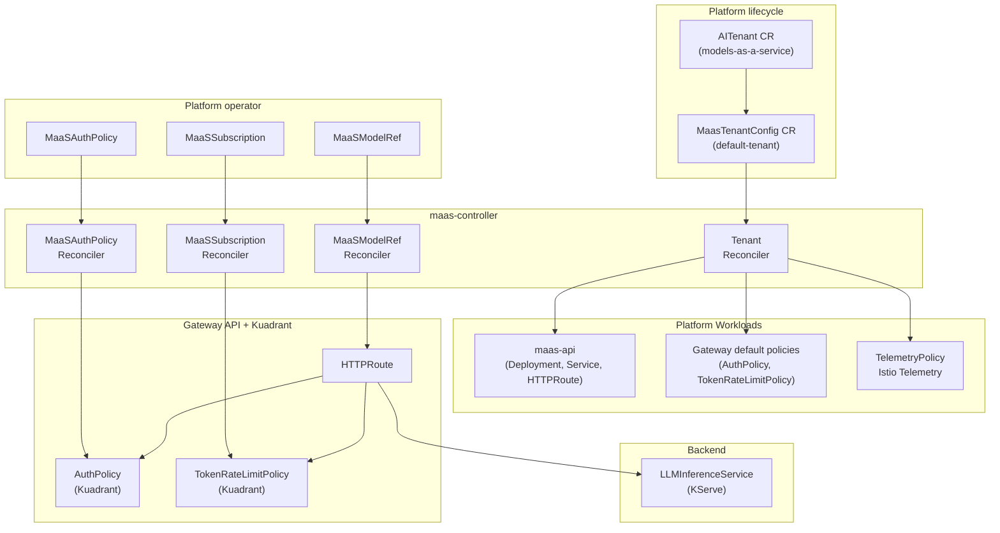
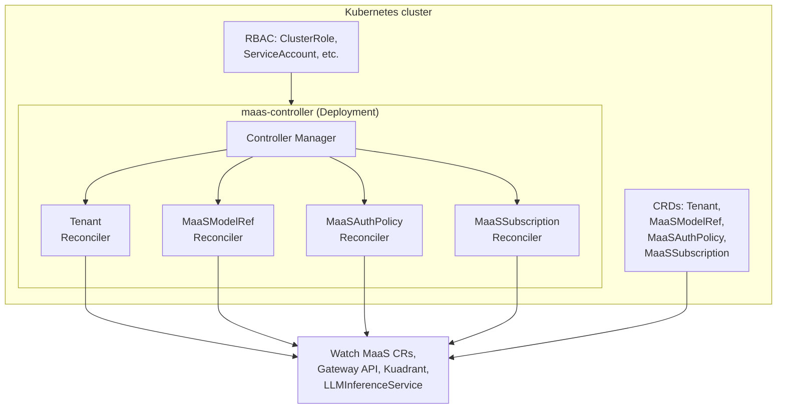
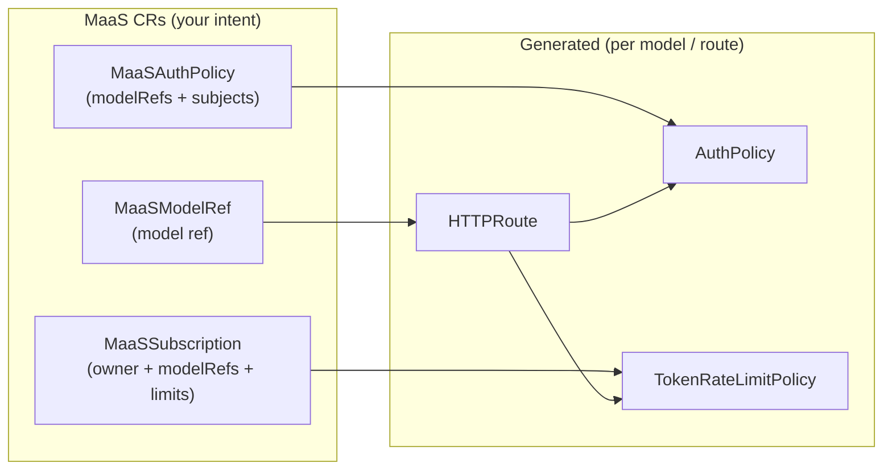
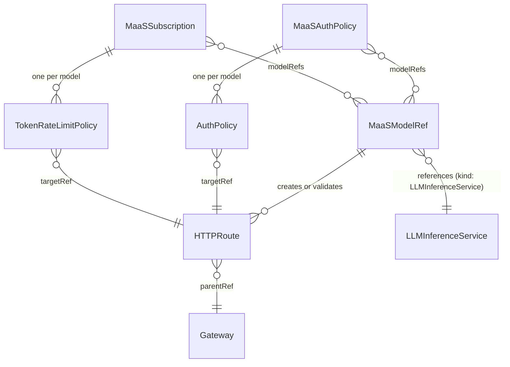

# MaaS Controller Architecture

This document provides a technical deep-dive into the MaaS Controller architecture, internal components, and resource model.

---

## Namespace Architecture

MaaS uses multiple namespaces to separate concerns and enable flexible deployment patterns:

| Namespace | Purpose | Default Value | Configurable |
|-----------|---------|---------------|--------------|
| **Controller Namespace** | Where maas-controller operator runs | `opendatahub` (ODH) `redhat-ods-applications` (RHOAI) | Set by operator/deployment |
| **Infrastructure Namespace** | Where maas-api deployment and maas-db-config secret run | Same as controller (default) `odh-ai-gateway-infra` (ODH separated) `redhat-ai-gateway-infra` (RHOAI separated) | `--infra-namespace` flag |
| **Default Tenant Namespace** | Where default Tenant CR and subscriptions live | `models-as-a-service` | `--maas-subscription-namespace` flag |
| **AITenant Namespace** | Where AITenant CRs are created | `ai-tenants` | `--aitenant-namespace` flag |
| **Gateway Namespace** | Where Gateway API resources live | `openshift-ingress` | `--gateway-namespace` flag |

**Key points:**

- **PostgreSQL location is independent:** The database can be external (AWS RDS, Azure Database, etc.) or in any namespace. Only the `maas-db-config` secret (containing the connection URL) needs to be in the infrastructure namespace.
- **Default behavior (no separation):** Infrastructure namespace equals controller namespace. This works on all clusters including ODH on ROSA.
- **Namespace separation:** When enabled, maas-api and related secrets deploy to a dedicated infrastructure namespace while the controller stays in its original namespace. See [Infrastructure Namespace Separation](../configuration-and-management/infra-namespace-migration.md) for migration details.

---

## API-Key Database Routing

`maas-api` stores API-key metadata in PostgreSQL. The database topology can provide a
writable primary through the multi-cluster service and a read replica in each cluster
where MaaS runs. The database is not deployed or modified by MaaS; GitOps supplies the
endpoints through the existing `maas-db-config` Secret in the infrastructure namespace.

### Secret and pool contract

| Secret key | Required | Pool | Purpose |
|------------|----------|------|---------|
| `DB_CONNECTION_URL` | Yes | Writable primary | Schema migrations, writes, and read fallback |
| `DB_READ_CONNECTION_URL` | No | Cluster-local read replica | API-key validation and administrative reads |

Keeping both keys in one Secret preserves the existing deployment contract and avoids a
second credential object that GitOps would need to coordinate. The writable key retains
its original meaning, so deployments that do not configure the optional key keep the
previous single-pool behavior. Values are trimmed, validated as PostgreSQL URLs, and never
logged.

Startup deliberately fails closed when an explicitly configured read URL is invalid or
unreachable. A silent fallback would make a deployment mistake look healthy while sending
all reads across clusters to the primary, defeating the purpose of the local replica.
After startup, both pools use the existing maximum-open, maximum-idle, and lifetime
settings and are closed independently during shutdown.

### Routing and consistency

Routing is method-based rather than based on a generic read-only transaction flag. That
keeps each method's consistency requirement explicit:

| Store operation | Initial pool | Reason |
|-----------------|--------------|--------|
| `GetByHash` | Read replica | This indexed lookup is the synchronous API-key validation hot path; keeping it local avoids a cross-cluster round trip on every authorized request |
| `Search`, `Get`, `List` | Read replica | Administrative reads tolerate ordinary asynchronous replication lag |
| `AddKey`, `BulkRevoke`, `InvalidateTenant`, `InvalidateSubscription`, `Revoke`, `UpdateLastUsed`, `DeleteExpiredEphemeral`, `DeleteSoftDeleted` | Writable primary | These operations mutate state or, for `BulkRevoke` dry-run, must count the same rows the subsequent mutation will change |

Configuring `DB_READ_CONNECTION_URL` opts into the hot-path latency optimization and its
consistency contract. A replica can return a still-active key after `Revoke` has committed
on the primary, so revocation visibility is bounded by replication lag plus any brief
Authorino cache. This is appropriate when the database topology provides a low, monitored
replication-lag objective. Deployments with a strict immediate-revocation requirement must
omit the read URL; they retain the previous behavior of validating hashes on the primary.

`UpdateLastUsed` remains on the writable primary, but it is asynchronous and debounced, so
it does not add a cross-cluster round trip to the validation response. Expiration state
transitions discovered by `GetByHash` are also writes and use the primary.

Schema migrations and concurrent index creation run only against the writable pool.
Replicas apply DDL through PostgreSQL replication, and sending migrations to a read-only
endpoint would either fail or create topology divergence.

### Failure and observability

Local reads retry once on the writable primary when the read query fails. The fallback
keeps API-key validation and key administration available during replica maintenance while
making the unexpected primary traffic visible. The process health endpoint reports the read
pool as degraded but remains healthy because an optional replica must not make the API
instance unready.

Metrics expose:

- Query counts by operation and selected pool
- Read-to-write fallback count
- Ping failures by pool
- Open, in-use, and idle connections by pool
- Replica lag from `pg_last_xact_replay_timestamp()` plus configured warning and critical thresholds

Lag is monitored but is not a routing input in this implementation. Disabling a replica
automatically because of lag would require an explicit availability and consistency policy;
operators should alert on lag and fallback rate instead. See
[Database Setup](../install/maas-setup.md#optional-postgresql-read-replica) for configuration.

---

## What Is the MaaS Controller?

The **MaaS Controller** is a Kubernetes controller with two main responsibilities:

1. **Tenant reconciler** — deploys and manages the MaaS platform workloads (`maas-api`, gateway policies, telemetry, DestinationRule) via the **`MaasTenantConfig`** CR (`maas.opendatahub.io/v1alpha1`). On startup the controller self-bootstraps `AITenant/models-as-a-service` in the `ai-tenants` namespace; the AITenant reconciler creates or adopts `MaasTenantConfig/default-tenant` in the `models-as-a-service` namespace. The Tenant reconciler renders embedded kustomize manifests at runtime and applies them via Server-Side Apply (SSA).

2. **Subscription reconcilers** — let platform operators define:
    - **Which models** are exposed through MaaS (via **MaaSModelRef**).
    - **Who can access** those models (via **MaaSAuthPolicy**).
    - **Per-user/per-group token rate limits** for those models (via **MaaSSubscription**).

The controller does not run inference. It **reconciles** your high-level MaaS CRs into the underlying Gateway API and Kuadrant resources (HTTPRoutes, AuthPolicies, TokenRateLimitPolicies) that enforce routing, authentication, and rate limiting at the gateway.

---

## High-Level Architecture

**Summary:** The controller has two sides: the **Tenant reconciler** deploys and manages the MaaS platform workloads (maas-api, gateway policies, telemetry) from the `MaasTenantConfig` CR and AITenant platform context; the **subscription reconcilers** turn MaaS CRs into Gateway/Kuadrant resources that attach to per-model HTTPRoutes and backends (e.g. KServe LLMInferenceService).

---

## Interaction with MaaS API (discovery)

The **MaaS API** is deployed as part of the **Tenant** platform bundle; it is not the same process as **maas-controller**, but the two work together: the controller **reconciles** **MaaSModelRef** and related CRs, and the API **lists** models from that cluster state for **GET /v1/models**.

For **GET /v1/models**, the MaaS API uses **MaaSModelRef** CRs as its primary source: it reads them cluster-wide (all namespaces), then **validates access** by probing each model's `/v1/models` endpoint with the client's **Authorization** header (passed through as-is). Only models that return 2xx or 405 are included. The catalogue returned to the client is the set of MaaSModelRef objects the controller reconciles, filtered to those the client can access. **No** token exchange is performed; the header is forwarded as-is.

!!! warning "Trust boundary: model discovery"
    The GET /v1/models flow forwards raw **Authorization** headers to model workloads during access validation. That creates a trust boundary:
    - **Model workloads must not log or forward raw Authorization headers** during discovery probes
    - **Operators should only register models trusted to handle credentials safely** via MaaSModelRef
    - For additional protections on model inference routes, see [Authentication Internals](./authentication-internals.md)
    - Future enhancements may include token exchange or credential mediation to reduce exposure during discovery

For end-user behavior and examples, see [Model Discovery](../user-guide/model-discovery.md) and [Model listing flow](../configuration-and-management/model-listing-flow.md).

---

## Component Diagram (Controller Internals)

- Single binary: **manager** runs four reconcilers (Tenant + three subscription reconcilers).
- Registers **Kubernetes core**, **Gateway API**, **KServe (v1alpha1)**, and **MaaS (v1alpha1)** schemes; uses **unstructured** for Kuadrant resources.
- Reads/writes MaaS CRs, HTTPRoutes, Gateways, AuthPolicies, TokenRateLimitPolicies, and LLMInferenceServices (read-only for model metadata/routes).

---

## What the Controller Creates (Runtime View)

| Your resource   | Controller creates / uses                                      |
|-----------------|-----------------------------------------------------------------|
| **MaaSModelRef**   | **HTTPRoute** (or validates KServe-created route for LLMInferenceService)  |
| **MaaSAuthPolicy** | One **AuthPolicy** per referenced model; targets that model's HTTPRoute |
| **MaaSSubscription** | One **TokenRateLimitPolicy** per referenced model; targets that model's HTTPRoute |

All generated resources are labeled `app.kubernetes.io/managed-by: maas-controller`.

---

## Data Model (Simplified)

- **MaaSModelRef**: `spec.modelRef.kind` = LLMInferenceService or ExternalModel; `spec.modelRef.name` = name of the referenced model resource.
- **MaaSAuthPolicy**: `spec.modelRefs` (list of ModelRef objects with name and namespace), `spec.subjects` (groups, users).
- **MaaSSubscription**: `spec.owner` (groups, users), `spec.modelRefs` (list of ModelSubscriptionRef objects with name, namespace, and either a `tokenRateLimits` array to define per-model rate limits or `unlimited: true` for no token budget).

---

## References

### Other internals (this guide)

- [Reconciliation Flow](./reconciliation-flow.md) — Ownership, watches, status, deletion lifecycle
- [Authentication Internals](./authentication-internals.md) — Subscription selection, TRLP keys, identity context

### Install and operations

- [MaaS Setup](../install/maas-setup.md) — Platform install, **Tenant** CR, gateway
- [Validation](../install/validation.md) — Post-install checks
- [Troubleshooting](../install/troubleshooting.md) — Common failures
- [Access and Quota Overview](../concepts/subscription-overview.md) — Subscriptions and access model
- [Quota and Access Configuration](../configuration-and-management/quota-and-access-configuration.md) — Quotas, auth policies, subscriptions

### Discovery and API

- [Model Discovery](../user-guide/model-discovery.md) — Using **GET /v1/models** from a client perspective
- [Inference](../user-guide/inference.md) — Calling inference endpoints
- [Model Listing Flow](../configuration-and-management/model-listing-flow.md) — How listing fits the platform
- [MaaS API Overview](../reference/maas-api-overview.md) — REST surface (discovery, keys, admin)

### Architecture context

- [Architecture](../concepts/architecture.md) — Product-level architecture (Concepts)
