# AI Gateway, MaaS & llm-d Architecture — RHOAI 3.6

Generated from https://github.com/opendatahub-io/architecture-context/tree/main/architecture/rhoai-3.6

```mermaid
graph TB
    %% ── Styles ──
    classDef operator fill:#4a90d9,stroke:#2c5282,color:#fff
    classDef controller fill:#48bb78,stroke:#276749,color:#fff
    classDef service fill:#ed8936,stroke:#c05621,color:#fff
    classDef proxy fill:#9f7aea,stroke:#6b46c1,color:#fff
    classDef crd fill:#f6e05e,stroke:#b7791f,color:#333
    classDef external fill:#fc8181,stroke:#c53030,color:#fff
    classDef db fill:#63b3ed,stroke:#2b6cb0,color:#fff
    classDef llmd fill:#38b2ac,stroke:#234e52,color:#fff

    %% ── External actors ──
    Client([Client]):::external
    LLMProvider([External LLM Providers<br/>OpenAI / Anthropic / etc.]):::external

    %% ════════════════════════════════════════════
    %% OPERATOR LAYER
    %% ════════════════════════════════════════════
    subgraph OperatorLayer["Operator Layer (opendatahub namespace)"]
        AGO[AI Gateway Operator]:::operator
    end

    %% ════════════════════════════════════════════
    %% CONTROL PLANE
    %% ════════════════════════════════════════════
    subgraph ControlPlane["Control Plane (opendatahub namespace)"]
        AGC[AI Gateway Controller]:::controller
        MaaSCtrl[MaaS Controller]:::controller
    end

    %% ════════════════════════════════════════════
    %% CRDs — AI Gateway Controller
    %% ════════════════════════════════════════════
    subgraph CRDs_AGC["CRDs managed by AI Gateway Controller"]
        ExternalModel[ExternalModel]:::crd
        ExternalProvider[ExternalProvider]:::crd
        AIGuardrail[AIGuardrail]:::crd
    end

    %% ════════════════════════════════════════════
    %% CRDs — MaaS Controller
    %% ════════════════════════════════════════════
    subgraph CRDs_MaaS["CRDs managed by MaaS Controller"]
        AITenant[AITenant]:::crd
        MaaSSubscription[MaaSSubscription]:::crd
        MaaSModelRef[MaaSModelRef]:::crd
        MaaSAuthPolicy[MaaSAuthPolicy]:::crd
        MaasTenantConfig[MaasTenantConfig]:::crd
        ConfigCR[Config]:::crd
    end

    %% ════════════════════════════════════════════
    %% CRDs — AI Gateway Operator
    %% ════════════════════════════════════════════
    subgraph CRDs_AGO["CRDs managed by AI Gateway Operator"]
        AIGatewayCR[AIGateway]:::crd
    end

    %% ════════════════════════════════════════════
    %% CRDs — llm-d
    %% ════════════════════════════════════════════
    subgraph CRDs_LLMD["CRDs — llm-d ecosystem"]
        InferencePool[InferencePool]:::crd
        InferenceObjective[InferenceObjective]:::crd
        LLMInfSvc[LLMInferenceService<br/>KServe]:::crd
    end

    %% ════════════════════════════════════════════
    %% DATA PLANE — Gateway
    %% ════════════════════════════════════════════
    subgraph DataPlane["Data Plane — Gateway (per-tenant namespace)"]
        Envoy[Envoy Proxy<br/>Gateway]:::proxy

        subgraph ExtProc["Praxis ExtProc"]
            PreProc[payload-pre-processing<br/>pre-processing · fail-open]:::service
            PostProc[payload-processing<br/>payload-processing · fail-closed]:::service
        end

        MaaSAPI[maas-api<br/>per-tenant]:::service
    end

    %% ════════════════════════════════════════════
    %% DATA PLANE — llm-d Inference Pool
    %% ════════════════════════════════════════════
    subgraph LLMDPlane["Data Plane — llm-d Inference Serving"]
        EPP[llm-d Router<br/>Endpoint Picker · EPP<br/>gRPC ext-proc :9002]:::llmd

        subgraph ModelServers["vLLM Model Servers"]
            PrefillPod[Prefill Pod<br/>vLLM :8000]:::llmd
            DecodePod[Decode Pod<br/>vLLM :8000]:::llmd
            PDSidecar[P/D Sidecar<br/>routing proxy]:::llmd
        end

        KVCache[(KV Cache<br/>NIXL / RDMA)]:::db
    end

    %% ════════════════════════════════════════════
    %% DEPENDENCIES
    %% ════════════════════════════════════════════
    PostgreSQL[(PostgreSQL)]:::db
    Kuadrant[Kuadrant / Authorino]:::service

    %% ── Operator deploys control plane ──
    AGO -->|deploys & manages| AGC
    AGO -->|deploys & manages| MaaSCtrl
    AGO -.->|reconciles| AIGatewayCR

    %% ── AI Gateway Controller relationships ──
    AGC -.->|reconciles| ExternalModel
    AGC -.->|reconciles| ExternalProvider
    AGC -.->|watches| AIGuardrail
    AGC -->|installs per-tenant| PreProc
    AGC -->|installs per-tenant| PostProc
    AGC -->|creates HTTPRoutes,<br/>ServiceEntries,<br/>DestinationRules| Envoy
    AGC -.->|watches| MaasTenantConfig

    %% ── MaaS Controller relationships ──
    MaaSCtrl -.->|reconciles| AITenant
    MaaSCtrl -.->|reconciles| MaaSSubscription
    MaaSCtrl -.->|reconciles| MaaSModelRef
    MaaSCtrl -.->|reconciles| MaaSAuthPolicy
    MaaSCtrl -.->|reconciles| MaasTenantConfig
    MaaSCtrl -.->|reconciles| ConfigCR
    MaaSCtrl -->|self-deploys per tenant| MaaSAPI
    MaaSCtrl -->|creates AuthPolicy| Kuadrant
    MaaSCtrl -.->|watches conditionally| LLMInfSvc
    MaaSCtrl -.->|creates per subscription| InferenceObjective

    %% ── CAS handshake between controllers ──
    AGC <-->|payload-processing-status<br/>CAS handshake via<br/>MaasTenantConfig annotations| MaaSCtrl

    %% ── llm-d EPP relationships ──
    EPP -.->|watches pods via| InferencePool
    EPP -.->|reads priority from| InferenceObjective

    %% ── Inference request flow — External Model path ──
    Client -->|"① HTTPS :443"| Envoy
    Envoy -->|"② gRPC :9004<br/>extract model name"| PreProc
    Envoy -->|"③ auth"| Kuadrant
    Kuadrant -->|"validate API key"| MaaSAPI
    Envoy -->|"④ gRPC :9004<br/>full processing"| PostProc
    Envoy -->|"⑤a external model<br/>HTTPS :443"| LLMProvider

    %% ── Inference request flow — On-cluster model path (llm-d) ──
    Envoy -->|"⑤b on-cluster model<br/>gRPC ext-proc :9002"| EPP
    EPP -->|"⑥ route to selected<br/>model server pod"| PDSidecar
    PDSidecar -->|"⑦ prefill request"| PrefillPod
    PrefillPod -->|"⑧ KV transfer<br/>NIXL / RDMA"| KVCache
    KVCache -->|"⑨ KV load"| DecodePod
    PDSidecar -->|"⑩ decode request"| DecodePod

    %% ── MaaS API dependencies ──
    MaaSAPI -->|API key storage| PostgreSQL

    %% ── Legend ──
    subgraph Legend
        direction LR
        L1[Operator]:::operator
        L2[Controller]:::controller
        L3[Service]:::service
        L4[Proxy]:::proxy
        L5[CRD]:::crd
        L6[External]:::external
        L7[llm-d]:::llmd
    end
```

## Component Summary

| Component | Role | Deployed By |
|-----------|------|-------------|
| **AI Gateway Operator** | Module operator; lifecycle manager for sub-components | opendatahub-operator |
| **AI Gateway Controller** | Reconciles ExternalModel/ExternalProvider; installs per-tenant Praxis ExtProc; publishes routing overlay | AI Gateway Operator |
| **MaaS Controller** | Manages tenant lifecycle, subscriptions, auth policies; self-deploys maas-api per tenant; creates InferenceObjective per subscription | AI Gateway Operator |
| **maas-api** | Per-tenant HTTP API for model listing, API key CRUD, subscription queries | MaaS Controller |
| **Envoy Proxy (Gateway)** | Ingress gateway with ExtProc filter chain for pre-processing and payload-processing | Platform (Istio/Gateway API) |
| **Praxis ExtProc (IPP)** | Two-stage Envoy ExtProc: pre-processing (model extraction, fail-open) and payload-processing (full pipeline, fail-closed) | AI Gateway Controller |
| **llm-d Router (EPP)** | Endpoint Picker — intelligent routing engine using ext-proc; KV-cache-aware, priority-driven pod selection | llm-d deployment (InferencePool) |
| **vLLM Model Servers** | Prefill and Decode pods serving LLM inference; disaggregated P/D architecture | KServe / LLMInferenceService |
| **P/D Sidecar** | Per-decode-pod reverse proxy orchestrating disaggregated prefill→decode KV transfer | Co-deployed with decode pods |
| **KV Cache (NIXL/RDMA)** | High-performance KV cache transfer between prefill and decode pods via GPUDirect RDMA | Infrastructure |

## Inference Request Flows

### External Model Path (steps ①–⑤a)

1. **Client → Envoy** — HTTPS request hits the Gateway on port 443
2. **Envoy → payload-pre-processing** — Pre-auth ExtProc extracts model name into `X-Gateway-Model-Name` header (fail-open)
3. **Envoy → Kuadrant/Authorino** — Gateway auth: API key, TokenReview, or OIDC JWT validation; calls maas-api for key validation
4. **Envoy → payload-processing** — Post-auth ExtProc runs full Praxis filter pipeline (fail-closed): request/response transformation, credential injection, guardrails
5. **Envoy → External LLM Provider** — Routed via ExternalName Service with TLS DestinationRule and provider API key injected by ExtProc

### On-Cluster Model Path (steps ①–④ then ⑤b–⑩)

Steps ①–④ are shared with the external path. Then:

5. **Envoy → llm-d EPP** — ext-proc call to the Endpoint Picker, which scores model server pods based on KV-cache utilization, queue depth, prefix affinity, and InferenceObjective priority
6. **EPP → P/D Sidecar** — Routes to the selected decode pod's sidecar proxy
7. **P/D Sidecar → Prefill Pod** — Sends prefill-only request to a prefill worker
8. **Prefill Pod → KV Cache** — KV cache written via NIXL/RDMA (GPUDirect)
9. **KV Cache → Decode Pod** — Decode pod loads KV state from cache
10. **P/D Sidecar → Decode Pod** — Sends decode request to local vLLM with KV transfer parameters

## Controller Coordination

- **AI Gateway Controller ↔ MaaS Controller** — Share a watch on `MaasTenantConfig` and coordinate the Praxis/legacy-IPP backend swap via optimistic-concurrency CAS on `payload-processing-type` and `payload-processing-status` annotations.
- **MaaS Controller → InferenceObjective** — Creates per-subscription InferenceObjective CRDs for priority scheduling, consumed by the llm-d EPP.
- **MaaS Controller → LLMInferenceService** — Conditionally watches KServe LLMInferenceService to track on-cluster model serving state.
