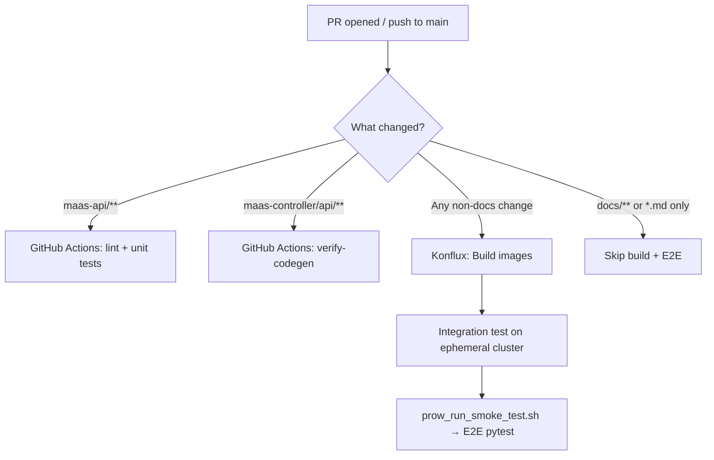

# MaaS Testing and Contribution Guide

This guide covers what tests exist in the MaaS project, how to run them, and how to add new tests when contributing a feature or fix.

## Test Overview

| Type | Location | Language | Runner |
|------|----------|----------|--------|
| **Unit tests** | `maas-api/internal/`, `maas-api/cmd/` | Go | `make test` |
| **Unit tests** | `maas-controller/pkg/` | Go | `make test` |
| **E2E tests** | `test/e2e/tests/` | Python (pytest) | `run-tests-quick.sh`, `smoke.sh` |
| **CI smoke / E2E** | `test/e2e/scripts/prow_run_smoke_test.sh` | Bash + pytest | Konflux integration |
| **Integration tests** | `test/integration/postgres.sh` | Bash | See [Integration Tests (PostgreSQL)](#integration-tests-postgresql) |
| **Integration tests** | [opendatahub-tests](https://github.com/opendatahub-io/opendatahub-tests) | Python (pytest) | ODH CI / Nightly |

### Repository Structure (Testing)

```
maas-api/
├── internal/**/*_test.go        # Unit tests for API handlers, services, auth
├── cmd/*_test.go                # Unit tests for CLI/server setup
└── test/fixtures/               # Shared Go test helpers (fakes, test data)

maas-controller/
└── pkg/**/*_test.go             # Unit tests for CRD reconcilers

test/e2e/
├── tests/                       # Pytest E2E test modules
│   ├── conftest.py              # Shared session-scoped fixtures
│   └── test_*.py                # Test modules (see table below)
├── fixtures/                    # Kustomize overlays for test CRs
├── scripts/prow_run_smoke_test.sh  # Full deploy + E2E (CI entrypoint)
├── smoke.sh                     # Run all E2E modules locally
├── run-tests-quick.sh           # Quick pytest run (no deploy)
└── requirements.txt             # Python dependencies
```

### E2E Test Modules and Groups

Tests are organized into **xdist groups** for parallel execution. All tests in a group run on the same pytest-xdist worker, and a worker takes the next queued group when it finishes one. See [Parallel E2E](#parallel-e2e-pytest-xdist) for details on how groups work.

### Smoke subset (`@pytest.mark.smoke`)

`/group-test` sets **`E2E_SMOKE_ONLY=true`** (via `.tekton/maas-group-test.yaml` podTemplate env), so PR passes 1–2 only collect tests marked `smoke`. That subset prioritizes basic API/gateway coverage, a light cross-slice of tenant/security/network checks, and the AGC external-model happy paths (default-tenant implicit attachment + user-namespace `gatewayRefs` serving). Heavier multi-tenant lifecycle, shared-model/conflict/lifecycle external-model suites, and serial mutators stay off the smoke path. `prow_run_smoke_test.sh` defaults to the **full suite** when the env var is unset, so nightly and other callers still cover tests marked neither `smoke` nor `nightly`.

- Local smoke subset: `./test/e2e/scripts/run_e2e_tests.sh --smoke-only` (or `E2E_SMOKE_ONLY=true`)
- Add new PR-critical coverage by marking individual tests/classes/modules with `@pytest.mark.smoke` (prefer read-only or shared-fixture paths over new AuthPolicy/AITenant churn)

| Group | Module | What it covers |
|-------|--------|---------------|
| `readonly` | `test_smoke.py`, `test_config_tenant.py`, `test_tenant.py`, `test_tenant_discovery.py`, `test_networkpolicy.py`, `test_authpolicy_generation_stability.py`, `test_gateway_filter_chain_praxis.py`, `test_xdist_config.py` | Read-only cluster/API checks |
| `legacy_ipp_filter_chain` | `test_gateway_filter_chain.py` | Legacy IPP filter order (`legacy_ipp` opt-in; not default CI) |
| `legacy_ipp_external_models` | `test_external_models.py` | Legacy ExternalModel routing (`legacy_ipp` opt-in) |
| `api_keys_core` | `test_api_keys.py` | API key CRUD, admin authorization, validation (`worker_tenant`) |
| `api_unconfigured_model` | `test_subscription.py`, `test_trlp_rate_grouping.py` | Subscription enforcement, rate limiting, TRLP grouping (`worker_tenant`) |
| `api_keys_sub_endpoints` | `test_subscription_list_endpoints.py` | Subscription listing endpoints (`worker_tenant`) |
| `api_xkey` | `test_x_api_key_auth.py` | X-API-Key header authentication |
| `api_embedding` | `test_embedding_inference.py` | Embedding inference (`worker_tenant`) |
| `models_endpoint` | `test_models_endpoint.py` | `/v1/models` subscription-aware filtering (`worker_tenant`) |
| `models_gw_authpolicy` | `test_gateway_scoped_authpolicy.py` | Gateway AuthPolicy structure and enforcement (`worker_tenant`) |
| `models_identity` | `test_model_identity_conflict.py` | MaaSModelRef model-identity collision (`worker_tenant`) |
| `models_mt_integration` | `test_multi_tenant_integration.py` | Multi-tenant lifecycle coexistence (`worker_tenant`) |
| `security` | `test_negative_security.py`, `test_namespace_scoping.py` | Security / namespace isolation on the default gateway |
| `mt_lc_aitenant` | `test_aitenant_lifecycle.py` | AITenant create/migrate/delete |
| `mt_lc_maas_api` | `test_multi_tenant_maas_api.py` | Per-tenant maas-api infra; dual-listener checks are `@nightly` |
| `mt_lc_ns_discovery` | `test_tenant_namespace_discovery.py` | Namespace-label discovery, webhook validation |
| `mt_lc_crd_watch` | `test_crd_watch_resilience.py` | CRD watch registration (`serial_exclusive`; pass 2a only) |
| `tenant_iso_auth` | `test_tenant_auth_isolation.py` | Cross-tenant key rejection, OIDC scoping |
| `tenant_iso_rate` | `test_tenant_rate_limit_isolation.py` | Per-tenant rate limit independence |
| `tenant_iso_sub` | `test_tenant_subscription_isolation.py` | Per-tenant subscription scoping |
| `tenant_iso_discovery` | `test_tenant_discovery_isolation.py` | Per-tenant `/v1/tenants` isolation |
| `tenant_inference` | `test_tenant_model_inference.py` | Cross-gateway auth isolation, per-Gateway AuthPolicy selectors |
| `tenant_ipp_legacy` | `test_per_tenant_ipp_isolation.py` | Legacy IPP stacks (`legacy_ipp_pass2b`; serial pass 2b, not pass 1) |
| `tenant_ipp_praxis` | `test_per_tenant_praxis_isolation.py` | Praxis per-tenant isolation |
| `tenant_ipp_ext_*` | `test_tenant_external_model_*.py` (one group per file, e.g. `tenant_ipp_ext_attach`) | AGC/Praxis external models on tenant gateways (pass 1; split for wall clock) |
| `tenant_ipp_extproc_*` | `test_praxis_extproc_restart.py`, `test_praxis_extproc_secret_rotation.py` | Praxis extproc lifecycle |
| `tenant_auto_resolve` | `test_tenant_auto_resolve.py` | MaaSModelRef tenant auto-resolution from gateway parentRef |
| `inference_priority` | `test_inference_priority.py` | Subscription `inferencePriority` / InferenceObjective (`serial`) |
| `echo_io` | `test_echo_large_io.py` | Large payload echo (`serial`) |
| `external` | `test_external_oidc.py`, `test_external_model_routing.py`, Grid governance modules | Externally gated OIDC/routing/admin tests |

Each test file declares exactly one `xdist_group` (see module-level `pytestmark`). Pass 1 runs parallel groups; `@serial_exclusive` runs alone in pass 2a; `@serial` and `@legacy_ipp_pass2b` run in pass 2b. Opt-in `@legacy_ipp` suites are excluded from default CI passes.

## Running Tests

### Unit Tests (Go)

=== "maas-api"

    ```bash
    cd maas-api
    make test    # runs go test with race detection + coverage
    make lint    # golangci-lint
    ```

=== "maas-controller"

    ```bash
    cd maas-controller
    make test    # runs go test with race detection + coverage
    make lint    # golangci-lint
    ```

Both generate a `coverage.html` report in their respective directories.

### Integration Tests (PostgreSQL)

Integration tests for `maas-api` verify JSONB storage, GIN index queries, and NULL handling against a real PostgreSQL database.

**Integration tests skip protection:**

Note: `TestPostgres` is compiled with the other unit tests. To avoid the postgresql integration tests running during unit testing with `make test` the following must be true for the postgresql tests to be included in `make test`.

- Build tag check (requires `-tags=integration`)
- `testing.Short()` check (skipped in short mode)
- Environment variable check (skips if `TEST_DATABASE_URL` not set)

`TEST_READ_DATABASE_URL` is optional. When it is not set, read-pool integration tests use
`TEST_DATABASE_URL` for both independent pools, which validates routing and fallback with
the real PostgreSQL driver. Set it to a real read-replica URL to exercise the deployed
database topology.

```bash
./test/integration/postgresql.sh
if [ $? -eq 0 ]; then 
  echo "Integration tests passed" 
fi
```

### E2E Tests (Python)

!!! note "Prerequisites"
    OpenShift cluster with MaaS deployed, `oc` logged in as cluster-admin, Python 3.10+ (3.11 recommended; pytest 9).

=== "Quick (local dev)"

    ```bash
    # Cluster must already have MaaS deployed
    ./test/e2e/run-tests-quick.sh

    # Run specific file or filter
    ./test/e2e/run-tests-quick.sh tests/test_api_keys.py
    ./test/e2e/run-tests-quick.sh -k test_create_api_key
    ```

=== "Smoke (all modules)"

    ```bash
    ./test/e2e/smoke.sh
    ```

=== "Full CI (deploy + test)"

    ```bash
    # Deploys the full platform, models, fixtures, then runs E2E
    ./test/e2e/scripts/prow_run_smoke_test.sh

    # Skip deploy if cluster is already set up
    SKIP_DEPLOYMENT=true ./test/e2e/scripts/prow_run_smoke_test.sh
    ```

=== "Direct pytest"

    ```bash
    cd test/e2e
    python3 -m venv .venv && source .venv/bin/activate
    pip install -r requirements.txt

    export GATEWAY_HOST="maas.apps.your-cluster.example.com"
    export E2E_SKIP_TLS_VERIFY=true

    # Match run_e2e_tests.sh (three passes):
    pytest tests/ -m "not serial and not serial_exclusive and not legacy_ipp and not legacy_ipp_pass2b" -n 5 --dist=loadgroup -v
    pytest tests/ -m "serial_exclusive and not legacy_ipp" -v
    pytest tests/ -m "((serial and not legacy_ipp) or legacy_ipp_pass2b) and not serial_exclusive" -v

    # Single file in pass 1 only:
    pytest tests/test_subscription.py -m "not serial and not serial_exclusive and not legacy_ipp and not legacy_ipp_pass2b" -v
    pytest tests/test_api_keys.py::TestAPIKeyCRUD -m "not serial and not serial_exclusive and not legacy_ipp and not legacy_ipp_pass2b" -v
    ```

### Key Environment Variables

The E2E framework auto-discovers most values from the cluster. These are the most common overrides:

| Variable | Description |
|----------|-------------|
| `GATEWAY_HOST` | Gateway hostname (required unless `MAAS_API_BASE_URL` is set) |
| `MAAS_API_BASE_URL` | Full MaaS API URL (auto-derived if not set) |
| `TOKEN` | User bearer token (falls back to `oc whoami -t`) |
| `ADMIN_OC_TOKEN` | Admin token; admin tests skip if unset |
| `E2E_SKIP_TLS_VERIFY` | Set `true` to skip TLS verification |
| `MODEL_NAME` | Override model ID (defaults to first from catalog) |
| `E2E_MODEL_PATH` | Override the model route path used by inference tests (for example, `/llm/facebook-opt-125m-simulated`; omit `/v1`) |
| `EXTERNAL_OIDC` | Set `true` to enable external OIDC tests |
| `E2E_PARALLEL_WORKERS` | pytest-xdist worker count for pass 1 (default `5`). Set to `1` for single-worker pass 1 without xdist; the serial passes are unaffected. |
| `E2E_SERIAL_WORKERS` | pytest-xdist lane count for serial pass 2b (default `1` everywhere, including CI). Lanes above 1 are implemented and were measured at 2 and 3 lanes, but they are **not enabled by default**: pass-2b files share the stored auth state of common models even across different `xdist_group`s, so concurrent lanes race (measured failure: `test_models_endpoint::test_empty_model_list`). Pass 2a is always one worker. |
| `LLMISVC_CONTROLLER_CPU_REQUEST` / `LLMISVC_CONTROLLER_CPU_LIMIT` | CPU that `deploy-platform.sh` gives `llmisvc-controller-manager` on the test cluster (defaults `1` / `2`; shipped is 100m). Set the limit empty to keep the shipped resources. |

See `test/e2e/tests/conftest.py` and individual test module docstrings for the full set of supported variables.

The governed chat/completions smoke regressions are covered by
`tests/test_smoke.py::test_chat_completions_gateway_alive` (non-streaming body
content) and `tests/test_smoke.py::test_chat_completions_streaming_sse`
(`text/event-stream`, JSON `data:` chunks, `data: [DONE]`). Both use the
governed `facebook-opt-125m-simulated` LLMInferenceService and MaaSModelRef
deployed by `scripts/deploy-models.sh`, plus the `simulator-subscription` API key
created by the `api_key_headers` fixture. `MODEL_NAME` selects the route/catalog
model, while `E2E_MODEL_NAME` sets the ID sent in the inference request body
(default `facebook/opt-125m`). The full CI runner sets `GATEWAY_HOST` and
`MODEL_NAME`; for a local run, set `GATEWAY_HOST` to the gateway hostname and
`MODEL_NAME` to the catalog model ID. Set `E2E_MODEL_PATH` when the catalog URL
does not identify the model route. SSE parsing is centralized in
`test_helper.assert_openai_sse_chat_stream`.

### Parallel E2E (pytest-xdist)

`run_e2e_tests.sh` and `run-tests-quick.sh` run **three marker-filtered passes** by default (default `E2E_PARALLEL_WORKERS=5`). Use `--serial-only` to run passes **2a and 2b** only; that mode skips pass 1. Direct `pytest` invocations must use the same selectors when a module mixes `@serial` and worker-tenant tests.

1. **Pass 1**: `-m "not serial and not serial_exclusive and not legacy_ipp and not legacy_ipp_pass2b"`
2. **Pass 2a (`serial_exclusive`)**: `-m "serial_exclusive and not legacy_ipp"`
3. **Pass 2b (serial)**: `-m "((serial and not legacy_ipp) or legacy_ipp_pass2b) and not serial_exclusive"` — includes `test_per_tenant_ipp_isolation` after parallel work. Full legacy IPP catalog (`test_external_models`, `test_gateway_filter_chain`) stays **`legacy_ipp` opt-in** only.

Set `E2E_PARALLEL_WORKERS=1` to disable xdist on pass 1 while keeping the serial/non-serial split (useful for debugging on shared clusters). Pass `./run_e2e_tests.sh --serial-only` only when intentionally limiting the run to serial mutators.

#### xdist Groups

Every test file must have a module-level `xdist_group` marker:

```python
import pytest

pytestmark = pytest.mark.xdist_group("api_keys")
```

All tests in a file run on the same xdist worker, grouped with other files sharing the same group name. Tests **without** an `xdist_group` marker are scattered round-robin across workers, which can cause resource conflicts.

#### Group Assignment Rules

When adding a new test file, assign it to a group using these criteria (in priority order):

1. **Mutation scope**: Tests that create, modify, or delete the same CRs (MaaSAuthPolicy, MaaSSubscription, MaaSModelRef, etc.) must be in the same group. This prevents two workers from concurrently mutating the same resource.

2. **Functional domain**: Group tests by what they exercise (for example `api_keys_core`, `models_endpoint`, `mt_lc_*`, `tenant_ipp_ext_*`).

3. **Read-only tests go in `readonly`**: Tests that only read cluster state (no creates, no deletes, no patches) belong in the `readonly` group. This group finishes fast and never conflicts with other groups.

4. **Self-managing tenant tests** use `mt_lc_*`, `tenant_iso_*`, `tenant_inference`, or `tenant_ipp_ext_*` groups. Legacy per-tenant IPP isolation (`test_per_tenant_ipp_isolation.py`) uses `legacy_ipp_pass2b` and runs in serial pass 2b, not pass 1.

5. **Externally-gated tests go in `external`**: Tests that require external infrastructure (Keycloak OIDC, external endpoints) and use `pytest.mark.skipif` to self-gate belong in the `external` group.

6. **Prefer existing groups over new ones**: Adding more groups increases cluster resource pressure. Only create a new group if the test's mutation scope genuinely conflicts with all existing groups. The exception is wall clock: with `--dist=loadgroup` pass 1 cannot finish before its longest group, so split a group whose runtime alone sets the pass length, as long as the parts share no tenants or CRs and make no negative assertions (quiet logs, counters) on components the others touch. Pass 1 has more groups than workers: xdist starts the groups with the most tests first and hands the rest to whichever worker drains first, so a long group with few tests starts late.

#### Serial markers

Tests that mutate **global** cluster state use `@pytest.mark.serial` or `@pytest.mark.serial_exclusive`:

```python
@pytest.mark.serial
def test_delete_shared_subscription_then_restore(self):
    ...

@pytest.mark.serial_exclusive  # pass 2a only — scales a control plane or deletes a cluster CRD
def test_scale_controller_for_status_patch(self):
    ...
```

- **`serial`**: shared-cluster mutators; run in **pass 2b** (with `@legacy_ipp_pass2b` tests), not pass 1.
- **`serial_exclusive`**: needs the whole cluster alone; run in **pass 2a** (single worker), never with pass 1 parallel work.

Use `@serial` when the test:

- Deletes or modifies a shared fixture (e.g., `simulator-subscription`, `simulator-access`)
- Scales or restarts a cluster operator (maas-controller, Kuadrant) but other parallel groups can resume after pass 2a
- Modifies cluster-scoped state that other groups depend on, without requiring an exclusive cluster window

Use `@serial_exclusive` when scaling a control plane to zero or deleting a cluster-scoped CRD that pass 1 still needs.

Do **not** use `@serial` for tests that only create/delete their own uniquely-named resources — those are safe to run in parallel within their group. Modules with `@pytest.mark.worker_tenant` skip worker bootstrap for any test marked `serial` or `serial_exclusive`.

## CI Pipeline

CI runs automatically on every PR and push to `main`. Here's how the different test types fit together:



| System | Trigger | What runs |
|--------|---------|-----------|
| **GitHub Actions** | `maas-api/**` changes | golangci-lint, `make test` (Go unit tests), image build |
| **GitHub Actions** | `maas-controller/api/**` or `deployment/**` changes | `make verify-codegen`, kustomize manifest validation |
| **Konflux** | Any non-docs PR or push to `main` | Builds multi-arch images, then runs full E2E on an ephemeral OpenShift cluster |

Konflux provisions a fresh cluster, deploys ODH + MaaS with the PR's built images, and runs `test/e2e/scripts/prow_run_smoke_test.sh`. `/group-test` opts into the smoke-marked subset (`E2E_SMOKE_ONLY=true`; see [Smoke subset](#smoke-subset-pytestmarksmoke)). Nightly builds use the same script without that flag (full passes 1–2); extended `@pytest.mark.nightly` coverage still requires `MAAS_PYTEST_INCLUDE_NIGHTLY=true` / OIDC jobs.

### Deploy phase timings and fail-fast

`/group-test` is sequential: cluster provision → **deploy + validate** → pytest. `prow_run_smoke_test.sh` writes UTC start/end stamps for `deploy_platform`, `deploy_models`, `validate`, `pytest_pass1`, and `pytest_pass2` to **`phase-timings.txt`**.

| Where | Path |
|-------|------|
| Local | `$PROJECT_ROOT/test/e2e/reports/phase-timings.txt` (or `$ARTIFACT_DIR` / `$ARTIFACTS` / `$LOG_DIR` if set) |
| Konflux / Prow | `artifacts/<job>/<step>/phase-timings.txt` (OpenShift CI copies `ARTIFACT_DIR`) |

Each line looks like `2026-08-19T20:01:02Z deploy_platform start`. A start without a matching end means that phase failed or the job was killed.

Readiness gates **fail the job before pytest** so a bad DSC, AuthPolicy, or ODH install does not burn another ~40 minutes of pytest:

- DataScienceCluster wait in `prow_run_smoke_test.sh` exits 1 and dumps DSC conditions.
- After models are applied, AuthPolicy `Enforced=True` is required (`wait_for_auth_policies_enforced` returns 1 on timeout). `SKIP_AUTH_CHECK` still defaults to true **before** models exist (RHOAIENG-48760 chicken-egg).
- `.github/hack/install-odh.sh` exits 1 if the operator webhook, DSCInitialization, or DataScienceCluster never become Ready.
- `validate-deployment.sh` retries after polling gateway/pods, not after a fixed 30s sleep.

`SKIP_DEPLOYMENT=true` still skips platform and model install; timings are then recorded only for validate and pytest.

!!! tip "Docs-only changes"
    PRs that only touch `docs/**` or `*.md` files skip Konflux builds and E2E entirely (controlled via CEL expressions in `.tekton/` pipeline definitions).

## Adding New Tests

### Adding a Go Unit Test

1. Create a `*_test.go` file next to the code you're testing (standard Go convention)
2. Use `testify/assert` and `testify/require` for assertions
3. For `maas-api` handlers: use `net/http/httptest` and the fake listers in `maas-api/test/fixtures/`
4. For `maas-controller` reconcilers: use `controller-runtime/pkg/client/fake` with scheme setup
5. Run `make test` in the relevant directory to verify

**Quick reference** — a minimal handler test in `maas-api`:

```go
func TestMyHandler_Returns200(t *testing.T) {
    req := httptest.NewRequest(http.MethodGet, "/v1/my-endpoint", nil)
    rec := httptest.NewRecorder()
    handler := NewMyHandler(/* fake dependencies */)

    handler.ServeHTTP(rec, req)

    require.Equal(t, http.StatusOK, rec.Code)
}
```

**Quick reference** — a minimal reconciler test in `maas-controller`:

```go
func TestMyReconciler_Succeeds(t *testing.T) {
    client := fake.NewClientBuilder().WithScheme(scheme).WithObjects(/* seed */).Build()
    r := &MyReconciler{Client: client, Scheme: scheme}

    result, err := r.Reconcile(ctx, reconcile.Request{NamespacedName: key})

    require.NoError(t, err)
    require.False(t, result.Requeue)
}
```

!!! tip "CRD codegen"
    If you modify API types under `maas-controller/api/`, run `make -C maas-controller generate manifests` and commit the generated files. CI will fail if they're stale.

### Adding an E2E Test

1. **Pick the right module** — add your test to an existing `test_*.py` file if it fits the scope (see the [E2E test modules table](#e2e-test-modules-and-groups)). Create a new module only if your feature doesn't fit any existing one.

2. **Assign an xdist group** — every test file must have a module-level `xdist_group` marker. Follow the [group assignment rules](#group-assignment-rules) to pick the right group. If adding to an existing file, it already has a group.

    ```python
    import pytest

    pytestmark = pytest.mark.xdist_group("api_keys")
    ```

3. **Mark serial tests** — if your test mutates shared cluster state (deletes shared fixtures, scales operators), add `@pytest.mark.serial`. See [Serial Marker](#serial-marker) for criteria.

4. **Use shared fixtures** — `conftest.py` provides session-scoped fixtures like `maas_api_base_url`, `headers`, `token`, `admin_headers`, `api_key`, etc. Import `TLS_VERIFY` from `conftest` for HTTP calls.

5. **Add test resources if needed** — if your feature requires new MaaS CRs (models, subscriptions, auth policies), add a kustomize overlay under `test/e2e/fixtures/` and include it in the base `kustomization.yaml`.

6. **Use pytest discovery for CI** — `run_e2e_tests.sh` collects every `test_*.py` module under `test/e2e/tests/`. New modules do not need a separate CI registration step. Give the module an appropriate `xdist_group` marker and mark cluster-wide mutations as `serial`. Mark PR-critical low-churn coverage with `@pytest.mark.smoke` so `/group-test` picks it up (`E2E_SMOKE_ONLY=true`).

7. **Use skip markers for optional features** — if your test depends on optional infrastructure (e.g., external OIDC, IPP ExternalModel CRD), gate it with `pytest.mark.skipif` so the same module runs cleanly in all environments.

## Integration Testing with ODH Operator

MaaS is a component of [Open Data Hub (ODH)](https://github.com/opendatahub-io). Beyond the in-repo E2E tests, MaaS is also validated as part of the broader ODH integration test suite in [opendatahub-tests](https://github.com/opendatahub-io/opendatahub-tests).

### How It Works

- The [opendatahub-tests](https://github.com/opendatahub-io/opendatahub-tests) repo contains cross-component integration tests for the entire ODH platform, including model serving and MaaS functionality.
- These tests run in ODH CI and nightly pipelines against full ODH deployments with all components installed.
- MaaS-related integration tests validate that MaaS works correctly when deployed through the ODH operator alongside KServe, Authorino, and other platform components.

### Contributing Integration Tests

If your change affects how MaaS integrates with the ODH operator or other ODH components, you may need to add or update tests in the `opendatahub-tests` repo:

1. Follow the [opendatahub-tests contributing guide](https://github.com/opendatahub-io/opendatahub-tests/blob/main/docs/CONTRIBUTING.md) and [developer guide](https://github.com/opendatahub-io/opendatahub-tests/blob/main/docs/DEVELOPER_GUIDE.md)
2. Tests are organized by component — look for MaaS-related tests under the relevant directory
3. The project uses [openshift-python-wrapper](https://github.com/RedHatQE/openshift-python-wrapper) for Kubernetes/OpenShift API interactions
4. Follow the project's [style guide](https://github.com/opendatahub-io/opendatahub-tests/blob/main/docs/STYLE_GUIDE.md) and run `pre-commit` checks before submitting

### When to Add In-Repo vs Integration Tests

| Scenario | Where to add tests |
|----------|-------------------|
| New MaaS API endpoint or controller behavior | In-repo: Go unit tests + E2E in `test/e2e/` |
| MaaS CRD changes or subscription logic | In-repo: controller unit tests + E2E |
| Interaction with ODH operator, KServe, or Authorino | `opendatahub-tests` repo |
| End-to-end model serving through the full ODH stack | `opendatahub-tests` repo |
| Bug fix with regression test | In-repo (unit or E2E depending on scope) |

## Test Ownership Across the AI Gateway Stack (AIGO / AIGC / MaaS)

AI Gateway now spans three repos: [ai-gateway-operator](https://github.com/opendatahub-io/ai-gateway-operator) (AIGO), [ai-gateway-controller](https://github.com/opendatahub-io/ai-gateway-controller) (AIGC), and this repo (MaaS). Where a test belongs depends on what it needs to observe, not which repo you happen to be changing:

| Repo | Owns | What it tests | Test suite |
|------|------|----------------|------------|
| **AIGO** | Component setup & dependency management | `AIGateway` CR reconciles to `Ready`; sibling controller Deployments (`maas-controller`, `ai-gateway-controller`, `batch-gateway-operator`) become `Available`; aggregate status (`ModelsAsAServiceReady`, etc.) rolls up correctly. Never the request path. | `test/e2e/*_test.go` (Go — deploy prereqs, create CR, assert status) |
| **AIGC** | Deploying the Praxis-backed stack + AIGC's own control-plane logic | Its own reconciliation logic (`pkg/tenant`, `pkg/render`, `pkg/controller` for ExternalModel/ExternalProvider) via real fixtures. For MaaS-level/request-path behavior, AIGC does **not** write new test content — it fetches and re-runs **this repo's own pytest suite** against its Praxis-backed deployment, pinned via `test/maas-e2e.lock`, proving the same behavior holds under Praxis as under IPP. | `test/kind-env`, `test/openshift-env` (real fixtures) + a runtime checkout of `test/e2e/tests/` from this repo in `test/maas-e2e/`, fetched at the commit pinned in `test/maas-e2e.lock` |
| **MaaS** (this repo) | The single source of truth for MaaS-level resource/request behavior | Subscription enforcement, auth policy, rate limiting, API-key lifecycle, and anything visible at the MaaS API/Gateway boundary — including OpenAI resource-API routing and identity-header propagation. Written once here, run twice: in-repo against IPP, and via AIGC's runtime checkout in `test/maas-e2e/` against Praxis. | `test/e2e/tests/*.py` (pytest) |

**The upstream-first rule:** if MaaS-level behavior has a coverage gap that's exposed while working in AIGC or AIGO, add the test to **this repo's** `test/e2e/tests/` first (skip-gated with `pytest.mark.skipif` if the behavior is genuinely Praxis-only, mirroring the existing `EXTERNAL_OIDC` skip pattern — see [Group Assignment Rules](#group-assignment-rules)), then have the downstream repo bump its pin to pick it up. Don't accept a parallel Go/mock test in AIGO, and don't let a bespoke copy accumulate in AIGC. [`ai-gateway-controller#37`](https://github.com/opendatahub-io/ai-gateway-controller/pull/37) is a worked example of this lifecycle: a gap was fixed upstream in MaaS ([#1508](https://github.com/opendatahub-io/models-as-a-service/pull/1508)); once it landed, AIGC removed its own side-workarounds and re-pinned `test/maas-e2e.lock`.

## Checklist: Adding a New Test

- [ ] **Unit test**: Add `*_test.go` alongside your source in `maas-api/` or `maas-controller/`; run `make test`
- [ ] **E2E test**: Add to an existing `test_*.py` or create a new module in `test/e2e/tests/`
- [ ] **xdist group**: Ensure the test file has a `pytestmark = pytest.mark.xdist_group("group_name")` marker (see [group assignment rules](#group-assignment-rules))
- [ ] **Smoke marker**: Add `@pytest.mark.smoke` only for low-churn PR coverage that should run under `E2E_SMOKE_ONLY` (avoid AuthPolicy/AITenant create/delete storms)
- [ ] **Serial marker**: Add `@pytest.mark.serial` if the test mutates shared fixtures or scales operators
- [ ] **Test fixtures**: If new CRs are needed, add a kustomize overlay in `test/e2e/fixtures/`
- [ ] **Pytest discovery**: Confirm the new module follows the `test_*.py` naming convention and is collected with `pytest tests/ --collect-only -q`
- [ ] **Skip markers**: Use `pytest.mark.skipif` for tests requiring optional infrastructure
- [ ] **Local validation**: Run `make test` and/or `./test/e2e/run-tests-quick.sh` before pushing
- [ ] **Integration tests**: If your change affects ODH operator integration, update tests in [opendatahub-tests](https://github.com/opendatahub-io/opendatahub-tests)
